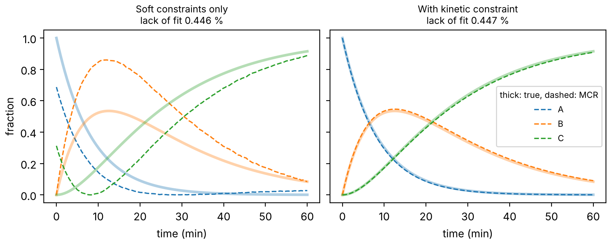
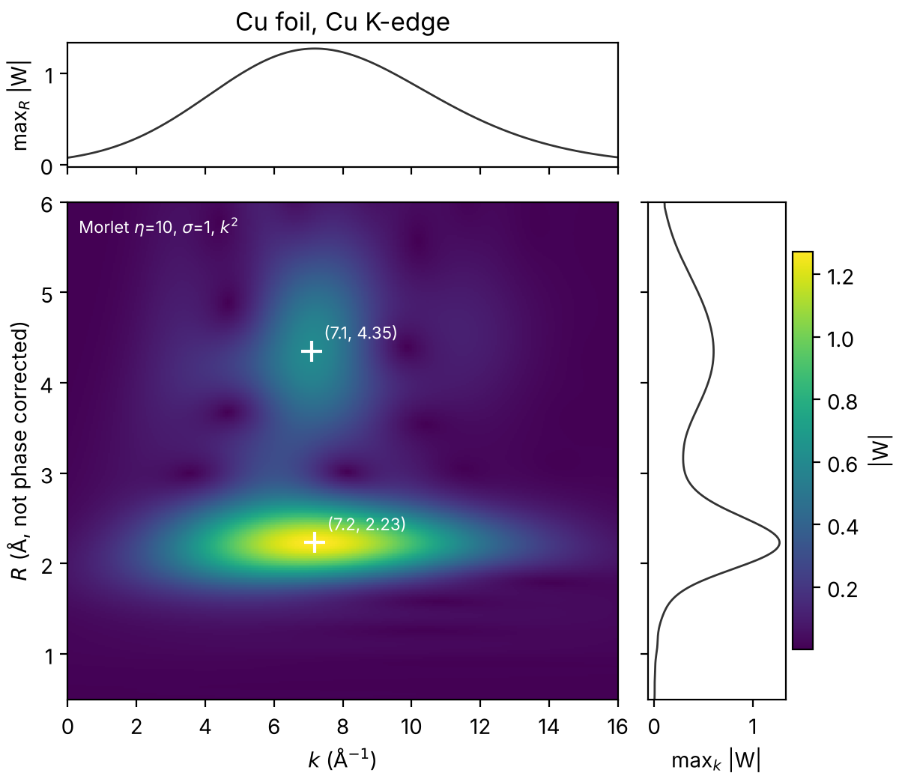

# xastk — XAS Toolkit

[](https://github.com/Rubin7599/xastk/actions/workflows/ci.yml)


**Reproducible, statistically validated XANES/EXAFS analysis on top of [xraylarch](https://github.com/xraypy/xraylarch).**

xastk does not replace Larch. It adds the parts that reviewers increasingly ask for and that no open
tool packages yet:

| Need | xastk module | Status |
| --- | --- | --- |
| Is an extra shell or cumulant justified? | `xastk.stats.hamilton_from_results` (Hamilton F-test) | v0.1 |
| Uncertainties that survive N–σ² and R–ΔE₀ correlation | `xastk.stats.sample_feffit` (MCMC on Larch `feffit`) | v0.1 |
| Operando series without pure references | `xastk.mcr` (PCA rank, MCR-ALS with closure and kinetic constraints) | v0.1 |
| Reproducible WT-EXAFS figures | `xastk.wt` (Morlet WT, lobe detection, composite plot) | v0.1 |
| Defensible background removal | `xastk.reduce.rbkg_stability` (AUTOBK R_bkg scan) | v0.1 |
| Physical sanity checks after every fit | `xastk.reduce.check_result` | v0.1 |
| Tables that are never retyped | `xastk.io` (result.json schema) + `xastk.report` (CSV, LaTeX, Word) | v0.1 |
| OriginPro figures | `xastk.report.export_bundle` / `run_bundle` | bundle v0.1, Origin runner untested |
| Model sets and detection limits for single-atom catalysts, Bayes factors, MCR ambiguity bands, multi-edge HEA constraints, Δμ-XANES | — | planned, see [roadmap](docs/technical-report.md#9-roadmap) |

Full design, mathematics and validation: **[docs/technical-report.md](docs/technical-report.md)**.

## Install

```bash
git clone https://github.com/Rubin7599/xastk && cd xastk
pip install -e ".[all]"        # core + Larch + emcee + python-docx + jsonschema
pytest                          # 49 tests, about 40 s
```

Python ≥ 3.11. The core (`numpy`, `scipy`, `matplotlib`) installs without Larch. Larch, emcee,
python-docx and originpro are optional extras: `[larch]`, `[stats]`, `[docx]`, `[origin]` (Windows).

## Thirty-second tour

```python
from larch.xafs import feffit
from xastk.stats import hamilton_from_results, sample_feffit
from xastk.io import result_from_feffit, save_result
from xastk.reduce import check_result
from xastk.report import rows_from_results, to_latex

out_a = feffit(pars_a, dataset_a)            # your usual Larch fits
out_b = feffit(pars_b, dataset_b)            # B = A + one more shell / cumulant

print(hamilton_from_results(out_a, out_b))   # F, confidence, significant?
mc = sample_feffit(out_a, seed=1)            # MCMC posterior, likelihood weighted by N_idp/N_pts
print(mc.table())

rec = result_from_feffit(out_a, sample="Fe-N-C", s02_ref=(0.85, 0.03))
save_result(rec, "runs/fe-n-c/result.json")
for flag in check_result(rec):
    print(flag)
print(to_latex(rows_from_results([rec])))
```

Command line:

```bash
xastk nidp 3 17 1.4 3.0
xastk hamilton --chi2-a 112.7 --nvar-a 4 --chi2-b 68.3 --nvar-b 5 --nidp 15.26
xastk rbkg data.xdi --mu mutrans --kmin 3 --kmax 16
xastk wt chi.dat --eta 10 --sigma 1 --out wt.png
xastk table runs/*/result.json --to csv latex docx --out si_table
xastk check runs/*/result.json --strict
```

See [docs/getting-started.md](docs/getting-started.md) and the runnable scripts in [examples/](examples/).

## Validated on real and synthetic data

| Check | Result |
| --- | --- |
| Cu foil, MCMC vs least squares | medians within 0.1 σ; posterior widths 7–10 % larger than Larch's errors |
| Cu foil, third cumulant | Hamilton confidence 0.973 → justified |
| Synthetic operando A→B→C | soft MCR: fit 0.446 %, concentration error 0.33; kinetic MCR: fit 0.447 %, error 0.012, rates within 4 % |
| Cu foil, R_bkg scan | recommends 1.1 Å (stable peak, minimal low-R residue, ≤ ½ first-shell R) |
| Morlet WT | ridge position matches the derived bias R(1 − 1/(2(ησ)²)) |

<p align="center"></p>
<p align="center"></p>

## Contributing and AI-assistance disclosure

Contributions are welcome. Please read [CONTRIBUTING.md](CONTRIBUTING.md). The v0.1 scaffold, code
and documentation were drafted with AI assistance (Claude, Anthropic, Opus 5.5 Max) and are under maintainer
review; see the contributing guide for the disclosure policy.

## Citation

See [CITATION.cff](CITATION.cff). Please also cite Larch, and the method papers listed in the
technical report for the analyses you use.

## License

MIT. Test data in `tests/data/` are from the Larch examples (MIT); see [tests/data/README.md](tests/data/README.md).
