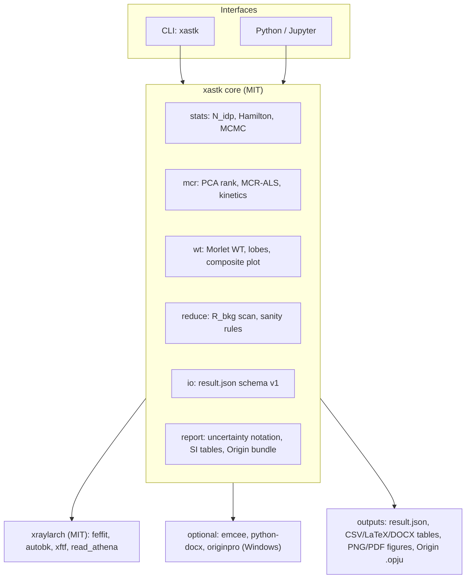
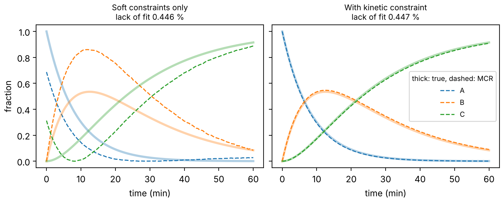
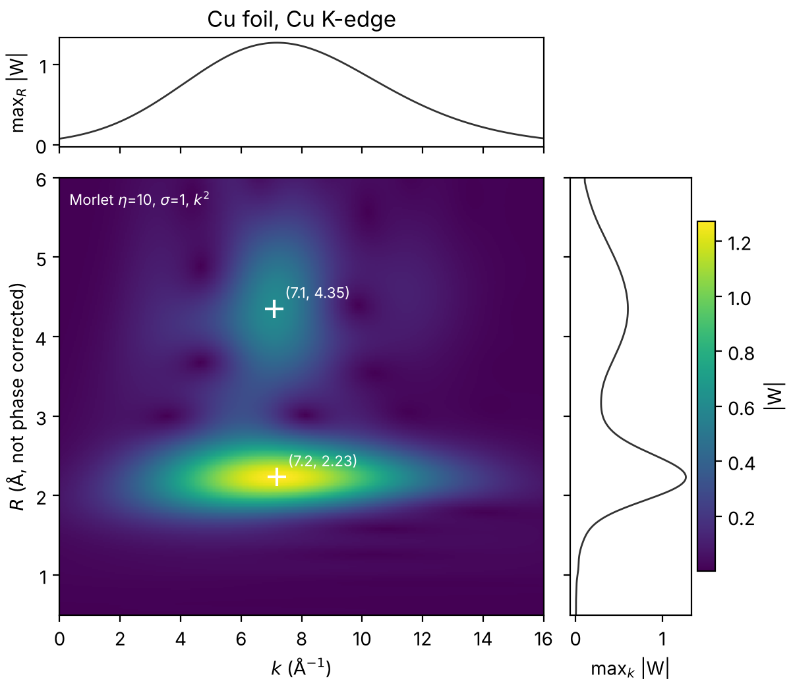

# xastk Technical Report

**Reproducible, statistically validated XAS analysis on top of xraylarch**

Version 0.1.0.dev0 · 2026-11-07 · Jhih-Jia Hung (Rubin) and contributors

---

## Abstract

X-ray absorption spectroscopy (XAS) papers in high-impact journals increasingly need analyses that
the open-source toolchain does not package: significance tests for added scattering shells,
posterior uncertainties for correlated parameters, deconvolution of operando series without pure
references, reproducible wavelet-transform (WT) EXAFS, and fitting tables that never pass through
manual retyping. `xastk` is an MIT-licensed Python package that adds these capabilities *on top of*
[xraylarch](https://github.com/xraypy/xraylarch) (Larch) instead of forking it. Version 0.1 provides
a Hamilton F-test and an MCMC posterior sampler for Larch `feffit` results, PCA rank estimation and
MCR-ALS with kinetic hard-model constraints, a distance-calibrated Morlet WT with lobe detection
and composite figures, an AUTOBK R_bkg stability scan, physical sanity checks, a versioned
`result.json` record, Supporting-Information table export (CSV, LaTeX, Word), and an
OS-independent figure-bundle format for OriginPro. Every numerical claim in this report is
reproduced by the test suite (49 tests) or by the scripts in `examples/`.

Key validation results:

- On the Larch Cu-foil example, MCMC posterior medians agree with the least-squares values to
  within 0.1 σ, and posterior widths are 7–10 % larger than Larch's standard errors once the
  likelihood is weighted by N_idp/N_pts (§5.3).
- A third cumulant on the Cu first shell is justified at 97.3 % confidence by the Hamilton test
  (§5.2).
- On a synthetic operando A → B → C series, unconstrained MCR-ALS fits the data to the noise level
  (lack of fit 0.446 %) while its concentrations are wrong by up to 0.33. Adding the kinetic
  constraint reduces the error to 0.012 and recovers both rate constants within 4 % (§5.4).

---

## Contents

1. [Motivation and scope](#1-motivation-and-scope)
2. [Ecosystem audit](#2-ecosystem-audit)
3. [Design principles](#3-design-principles)
4. [Architecture](#4-architecture)
5. [Methods, implementation and validation](#5-methods-implementation-and-validation)
6. [The result.json record](#6-the-resultjson-record)
7. [Team reproducibility workflow](#7-team-reproducibility-workflow)
8. [Open methodological gaps (planned work)](#8-open-methodological-gaps-planned-work)
9. [Roadmap](#9-roadmap)
10. [Validation summary](#10-validation-summary)
11. [Known limitations and risks](#11-known-limitations-and-risks)
12. [Licensing and contribution policy](#12-licensing-and-contribution-policy)
13. [References](#13-references)

---

## 1. Motivation and scope

Three recurring problems motivate the package.

1. **Statistical defensibility.** EXAFS fits routinely add shells, cumulants or mixed scatterers
   near the information limit N_idp. Reviewers ask whether the extra parameters are justified, and
   whether quoted uncertainties survive strong parameter correlations (N–σ², R–ΔE₀). The Hamilton
   F-test has been adapted to EXAFS for two decades [5] but is rarely applied, and Larch's `feffit`
   performs least squares only.
2. **Operando data without references.** Time- or potential-resolved series often contain
   intermediates that cannot be isolated, so linear-combination fitting has nothing to combine.
   MCR-ALS is the established alternative [9, 10], but its rotational ambiguity means a good fit
   does not prove a correct decomposition [11].
3. **Reproducibility.** Analysts working on the same spectrum obtain different coordination
   numbers because S0², R_bkg, the k/R windows and the constraints are chosen by hand and rarely
   recorded. Tables in the Supporting Information are retyped from screenshots or log files.

**Scope of v0.1.** Library + CLI for the items in the abstract. Out of scope for v0.1 and planned
in §8–§9: Bayes factors and nested sampling, MCR ambiguity bands, single-atom-catalyst model sets
with detection limits, multi-edge high-entropy constraint generation, Δμ-XANES automation, and a
team dashboard.

---

## 2. Ecosystem audit

Twelve repositories were cloned and inspected on 2026-11-07 (license file, git history, source
tree). Larch is the only actively maintained, permissively licensed XAS analysis engine among them.

| Repository | License | Last commit · activity | Role for xastk |
| --- | --- | --- | --- |
| [xraypy/xraylarch](https://github.com/xraypy/xraylarch) | MIT | 2026-11-05 · 398 commits in 2026 | **Core dependency.** Wrapped, never forked |
| [bruceravel/demeter](https://github.com/bruceravel/demeter) | Perl Artistic | 2025-06-03 · maintenance only; last binary release 0.9.26 (2018) [2] | Athena `.prj` files read through Larch `read_athena` |
| [gudasergey/pyFitIt](https://github.com/gudasergey/pyFitIt) | GPL-3.0 | 2024-12-23 | Optional plugin only (license isolation, §12) |
| [gudasergey/XANES_descriptors](https://github.com/gudasergey/XANES_descriptors) | none found | 2021-11-02 | Cite; re-implement from the paper [17] |
| [pnnl/DeepONets_for_spectroscopy](https://github.com/pnnl/DeepONets_for_spectroscopy) | BSD (PDF) | 2023-09-13 | Reference for XANES→EXAFS learning [16] |
| [Himmelspol/wtEXAFS](https://github.com/Himmelspol/wtEXAFS) | GPL-3.0 | 2023-05-05 · Windows-only, pinned numpy 1.22 | Same Morlet convention; xastk is a clean-room implementation |
| [wangmiaoX/wavelet-transform-exafs](https://github.com/wangmiaoX/wavelet-transform-exafs) | none found | 2022-01-14 · single C file | Validation target only |
| [hellozhaoming/wtexfas](https://github.com/hellozhaoming/wtexfas) | CC0-1.0 | 2020-05-09 · Electron app | UI reference |
| [khanlatif001/CCWT_EXAFS](https://github.com/khanlatif001/CCWT_EXAFS) | MIT | 2026-07-09 · two scripts | Plot-layout ideas; Cauchy WT duplicates Larch `cauchy_wavelet` |
| [usnistgov/pyMCR](https://github.com/usnistgov/pyMCR) | NIST public domain | 2021-10-26 | Superseded for XAS by `xastk.mcr` (kinetic constraints) |
| [mretegan/crispy](https://github.com/mretegan/crispy) | MIT | 2026-10-19 | Optional link for multiplet pre-edge interpretation |
| [xraypy/xraydb](https://github.com/xraypy/xraydb) | public domain | 2026-06-06 | Edge energies, cross-sections (via Larch) |

Not verified: the ESRF GitLab `retegan/xanes-descriptors` repository (unreachable from the build
environment) and the public repository of XASDAML [18].

**What Larch provides and what it lacks.** Verified in the Larch source (version 2026.3.1):
`feffit` computes N_idp = 1 + 2ΔkΔR/π, χ², reduced χ², R-factor, AIC and BIC, propagates
uncertainties to path parameters, and always calls `Minimizer.leastsq()`. There is no F-test, no
sampler, no MCR-ALS (only PCA and NMF in `larch.math.pca`), and the only wavelet is the Cauchy
wavelet (`larch.xafs.cauchy_wavelet`).

---

## 3. Design principles

1. **Wrap, don't fork.** Larch stays the numerical engine. xastk reads Larch objects and writes its
   own records. Upstream fixes go to Larch through its normal review process (§12).
2. **One record per fit.** Figures, tables, sanity checks and audit logs are generated from a
   single `result.json` (§6). Nothing is retyped.
3. **Light core, optional extras.** `import xastk` needs NumPy, SciPy and Matplotlib only. Larch,
   emcee, python-docx and originpro are imported inside the functions that need them.
4. **License isolation.** The core is MIT. GPL tools (pyFitIt, wtEXAFS) may only be used through
   separately distributed plugins. Code from repositories without a license is never copied.
5. **Every claim is a test.** Numbers quoted in this report are asserted in `tests/` or printed by
   `examples/`. Larch internals that xastk depends on are pinned by golden-value tests so an
   upstream change fails CI instead of silently changing results.

---

## 4. Architecture



| Module | Public API (v0.1) | Depends on |
| --- | --- | --- |
| `xastk.stats` | `n_idp`, `nvar_budget`, `hamilton_test`, `hamilton_from_results`, `sample_feffit` | SciPy; Larch + emcee for `sample_feffit` |
| `xastk.mcr` | `pca_rank`, `mcr_als`, `KineticModel`, `CONSECUTIVE`, `FIRST_ORDER` | NumPy, SciPy |
| `xastk.wt` | `morlet_wt`, `find_lobes`, `plot_wt_composite` | NumPy, SciPy, Matplotlib |
| `xastk.reduce` | `rbkg_stability`, `check_result`, `Rules` | Larch for `rbkg_stability` |
| `xastk.io` | `result_from_feffit`, `save_result`, `load_result`, `validate_result` | jsonschema (optional) |
| `xastk.report` | `format_value`, `format_two`, `rows_from_results`, `to_csv`, `to_latex`, `to_docx`, `export_bundle`, `run_bundle` | python-docx, originpro (optional) |

CLI commands: `xastk nidp`, `xastk hamilton`, `xastk table`, `xastk check`, `xastk wt`,
`xastk rbkg` (see [getting-started.md](getting-started.md)).

---

## 5. Methods, implementation and validation

All validation numbers below come from the Larch Cu-foil example (`cu_metal_rt.xdi`, first shell,
k = 3–17 Å⁻¹, R = 1.4–3.0 Å, k² weighting, Kaiser window dk = 4, R_bkg = 1.0 Å), which is shipped
in `tests/data/` with attribution, or from synthetic data defined in the tests.

### 5.1 Information content

$$N_\mathrm{idp} = 1 + \frac{2\,\Delta k\,\Delta R}{\pi}\quad(\text{Larch}),\qquad
N_\mathrm{idp}^\mathrm{Stern} = 2 + \frac{2\,\Delta k\,\Delta R}{\pi}\ [3].$$

`n_idp(kmin, kmax, rmin, rmax, convention)` implements both, plus the bare Nyquist estimate.
For the Cu example it returns 15.260, identical to Larch. `nvar_budget` flags fits with
N_var > ⅔ N_idp. The ⅔ factor is a lab convention, not a theorem; Bayesian work shows the
effective information content is lower than the Nyquist count when parameters correlate [7, 8].

### 5.2 Hamilton (F) test for nested models

For a simple model A with p_A variables nested in a richer model B with p_B variables, both fitted
to the same data and windows:

$$F = \frac{(\chi^2_A - \chi^2_B)/(p_B - p_A)}{\chi^2_B/(N_\mathrm{idp} - p_B)},\qquad
\text{confidence} = F_\mathrm{cdf}(F;\, p_B - p_A,\, N_\mathrm{idp} - p_B).$$

This follows Hamilton [4] in the form adapted to EXAFS by Downward et al. [5]. Because it uses a
ratio of χ² values, the poorly known absolute noise level largely cancels. `hamilton_from_results`
takes two Larch results, uses Larch's N_idp-scaled `chi_square`, and refuses comparisons whose
fit ranges differ. A confidence ≥ 0.95 is reported as significant; 0.67–0.95 should be reported
with its value rather than as a yes/no.

**Validation.** Cu first shell, model A (S0², ΔE₀, σ², ΔR) vs model B (+ third cumulant C3):
F = 6.675 with (1, 10.26) degrees of freedom, confidence 0.973. Anharmonicity of the Cu–Cu bond at
room temperature is therefore statistically supported by these data.

### 5.3 MCMC posterior for `feffit` results

**Why a weighted likelihood.** Larch evaluates the residual r_i on N_pts points (104 R-space points
in the Cu example), but those points carry only about N_idp ≈ 15 independent pieces of
information. Treating them as independent would shrink posterior widths by roughly
√(N_pts/N_idp) ≈ 2.6. xastk uses the same down-weighting that Larch applies to χ²:

$$\ln\mathcal{L}(\theta, s) = -\tfrac{1}{2}\,w\left[\frac{\sum_i r_i(\theta)^2}{s^2} + N_\mathrm{pts}\ln s^2\right],
\qquad w = \frac{N_\mathrm{idp}}{N_\mathrm{pts}}.$$

The noise scale s is sampled jointly with a flat prior on ln s, so results do not hinge on Larch's
ε estimate. Priors on the structural variables are uniform within each parameter's `min`/`max`,
intersected with optional user bounds (for example σ² ∈ (0, 0.05) Ų). Sampling uses emcee's
affine-invariant ensemble sampler [12].

**Implementation notes.** `sample_feffit(result, nwalkers, nsteps, burn, thin, bounds, seed)` calls
Larch's internal residual (`larch.xafs.feffit._feffit_resid`). That call re-creates the path
parameters, which drops their propagated uncertainties; xastk snapshots them, restores the
best-fit values in a `finally` block, re-evaluates the model once at the best fit (so stored model
arrays match the best fit again), and restores the path-parameter uncertainties. A regression test
covers this behaviour, which was found while building the package.

**Validation** (32 walkers × 3000 steps, burn-in 1000, thin 10, seed 1; `examples/01_cu_statistics.py`):

| Variable | Least squares | Larch 1σ | MCMC median | MCMC 1σ | MCMC/LSQ width |
| --- | --- | --- | --- | --- | --- |
| S0² (`amp`) | 0.93056 | 0.0391 | 0.93167 | 0.0420 | 1.07 |
| ΔE₀ (eV) | 4.3578 | 0.511 | 4.3386 | 0.546 | 1.07 |
| σ² (Ų) | 0.0086697 | 0.000308 | 0.0086859 | 0.000338 | 1.10 |
| ΔR (Å) | −0.0060167 | 0.00261 | −0.0060894 | 0.00285 | 1.09 |

Acceptance fraction 0.55. Posterior correlations: S0²–σ² +0.93, ΔE₀–ΔR +0.92. For this well-posed
single-shell fit the posterior is close to Gaussian. Medians sit within 0.1 σ of the least-squares
values, and widths are 7–10 % larger because the noise scale is marginalized. The sampler's value
is for ill-posed fits (light-scatterer mixtures, multi-shell fits near N_idp), where least-squares
covariances are known to be unreliable [6]. Those cases are the target of the Phase 2 benchmarks.

### 5.4 Operando deconvolution: PCA rank and MCR-ALS with kinetic constraints

**Number of components.** `pca_rank` computes singular values and Malinowski's indicator
function [13]:

$$\mathrm{RE}(n) = \sqrt{\frac{\sum_{j>n}\lambda_j}{r\,(c-n)}},\qquad \mathrm{IND}(n) = \frac{\mathrm{RE}(n)}{(c-n)^2},$$

with r ≥ c the matrix dimensions and λ_j = s_j². The minimum of IND selects n.

**Bilinear model.** D (n_t × n_E) = C S + E. Each ALS iteration solves for C given S, applies
non-negativity and closure (rows of C sum to one, i.e. conservation of the absorbing element),
optionally replaces C by the best-fitting kinetic hard model, then solves for S and applies
non-negativity. This hybrid hard–soft scheme is known to remove most rotational ambiguity [14].
For consecutive first-order kinetics A → B → C:

$$C_A = e^{-k_1 t},\quad C_B = \frac{k_1}{k_2 - k_1}\left(e^{-k_1 t} - e^{-k_2 t}\right),\quad C_C = 1 - C_A - C_B,$$

with the k₁ = k₂ limit C_B = k₁ t e^{−k₁t} handled explicitly. Rate constants are fitted in
log space, which keeps them positive and well conditioned.

**Validation** (synthetic series: three edge-plus-white-line spectra, 120 time points, k₁ = 0.12
and k₂ = 0.05 min⁻¹, Gaussian noise 0.004; initial spectra = first, middle and last measured
spectrum; `examples/02_operando_mcr.py`). IND has its minimum at n = 3.

| Variant | Lack of fit | max \|C − C_true\| | max \|S − S_true\| | k₁, k₂ (min⁻¹) |
| --- | --- | --- | --- | --- |
| Non-negativity + closure | 0.446 % | 0.327 | 0.488 | — |
| + kinetic A → B → C | 0.447 % | 0.012 | 0.018 | 0.1227, 0.0482 |



The two fits are statistically indistinguishable, yet the unconstrained concentrations are wrong
by up to 0.33. **Lack of fit cannot validate an MCR decomposition.** Results must come with either
a physical constraint, as here, or an explicit ambiguity analysis (planned, §8.4).

### 5.5 Morlet wavelet transform

xastk uses the distance-calibrated Morlet form of Funke et al. [15] (the convention also used by
wtEXAFS). With x = 2r(k − k′)/η:

$$\psi(x) = \frac{1}{\sqrt{2\pi}\,\sigma}\,e^{i\eta x}\,e^{-x^2/(2\sigma^2)},\qquad
W(k', r) = \sqrt{\frac{2r}{\eta}}\int \chi(k)\,k^n\,\psi^{*}\!\left(\frac{2r(k-k')}{\eta}\right)dk.$$

The carrier e^{iηx} = e^{2ir(k−k′)} oscillates like sin(2kR), so |W| peaks near r = R before
phase correction, as |χ(R)| does. The Gaussian envelope has a k-width of about Δk = ησ/(2r), and
ΔR ≈ 1/(2Δk). A large product ησ gives sharper R and broader k ("overview" wavelet); ησ ≈ 5
resolves light and heavy backscatterers at the same distance ("detail" wavelet) [15].

**Ridge bias (derived for this report).** For a single undamped shell χ = sin(2kR), the
Gaussian integral gives |W(r)| ∝ r^{−1/2} exp[−(ησ)²(R − r)²/(2r²)]. Setting d ln|W|/dr = 0 and
expanding near r = R yields

$$r_\mathrm{max} \approx R\left(1 - \frac{1}{2(\eta\sigma)^2}\right).$$

For R = 2.5 Å and ησ = 5 this predicts r_max = 2.450 Å; the implementation gives 2.454 Å. For
ησ = 10 the bias falls to 0.5 %. This is the quantitative form of Funke's remark that r and R
coincide only asymptotically for large ησ. Lobe positions should be reported together with ησ,
or with this correction applied.

**Lobe detection.** `find_lobes` finds local maxima of |W| above a relative threshold and refines
each position with a three-point parabola along k and along r.

**Validation.** (i) Single shell at 2.5 Å: one lobe at the predicted biased position for ησ = 5
and 10 (test tolerance 0.03 Å). (ii) Two scatterers at the same R = 2.2 Å with k-envelopes centred
at 4 and 10 Å⁻¹ (η = 7.5, σ = 0.5): two lobes at k = 4.05 and 9.99 Å⁻¹. (iii) Cu foil, k²,
η = 10, σ = 1: first-shell lobe at k = 7.19 Å⁻¹, R = 2.233 Å (not phase corrected) and a weaker
lobe at R = 4.35 Å, from the outer shells and multiple-scattering paths.



The composite figure uses a perceptually uniform colormap (viridis), marginal max-projections
along k and R, lobe markers with coordinates, and prints η, σ and the k-weight on the panel.

### 5.6 AUTOBK R_bkg stability scan

`rbkg_stability` runs Larch `pre_edge` → `autobk` → `xftf` on a grid of R_bkg (default
0.6–1.4 Å in 0.1 Å steps) and records the first-shell peak height and position, and the mean
|χ(R)| in a fixed low-R window [0, 0.9 Å]. The recommendation rule:

1. *stable*: the first-shell peak height lies within 5 % of the grid median;
2. *allowed*: R_bkg ≤ 0.5 × the first-shell peak position, so the spline cannot follow the first
   shell;
3. among stable and allowed values, take the one with the smallest low-R residue.

**Validation (Cu foil, k = 3–16 Å⁻¹, shell window 1.6–2.8 Å).** Peak heights range from 3.890 to
3.911 (all stable). The low-R residue falls from 0.157 at R_bkg = 0.6 Å to 0.020 at 1.1 Å. Values
above 1.12 Å are excluded by rule 2, so the scan recommends **R_bkg = 1.1 Å**. The scan table is
part of the record, so a reviewer can see the choice was not arbitrary.

An earlier draft recommended the *smallest* stable R_bkg. On Cu it returned 0.6 Å, which leaves
visible low-R residue, so the rule was changed to the one above.

### 5.7 Post-fit physical sanity checks

`check_result` returns warnings, never hard failures:

| Code | Default rule | Source of default |
| --- | --- | --- |
| `nidp_budget` | N_var ≤ ⅔ N_idp | lab convention |
| `correlation` | \|corr\| ≤ 0.90 for every variable pair | lab convention |
| `sigma2_range` | 0.002 ≤ σ² ≤ 0.03 Ų (σ² ≤ 0 is a warning, otherwise info) | SAC review table [19] |
| `e0_range` | \|ΔE₀\| ≤ 10 eV | [19] |
| `s02_range` | 0.7 ≤ S0² ≤ 1.05 (info) | [19] |
| `cn_uncertainty` | relative CN error ≤ 25 % | ~20 % commonly accepted [20] |
| `r_reference` | \|R − R_expected\| ≤ 0.10 Å for paths with a reference distance | user supplied |

On the Cu example the checks raise exactly two warnings: S0²–σ² (0.93) and ΔE₀–ΔR (0.92). Both are
expected for a single-shell fit and should be stated in the paper rather than hidden.

### 5.8 Uncertainty notation

`format_value(value, unc, style)` produces `1.95(4)`, `1.95 ± 0.04` or LaTeX. The number of
significant digits follows the Particle Data Group rule: take the three leading digits h of the
uncertainty. If 100 ≤ h ≤ 354, keep two digits; if 355 ≤ h ≤ 949, keep one; if h ≥ 950, round up
to 1000 and keep two. The value is rounded to the same decimal place.

All rounding uses `decimal.Decimal` with ROUND_HALF_UP on the decimal representation. Binary
floats store 0.975 as 0.97499…, so float formatting gives 0.97 where a reader expects 0.98.

| Input | Output |
| --- | --- |
| 1.9512 ± 0.0412 | 1.95(4) |
| 8.6 ± 1.0 | 8.6(10) |
| 0.00910 ± 0.00031 | 0.00910(31) |
| 12.3 ± 0.096 | 12.30(10) |
| 0.975 ± 0.0391 | 0.98(4) |
| 1234 ± 56 | 1230(60) |

`format_two(value, stat, choice)` prints both a statistical and a choice uncertainty (§7), for
example `4.13(30)(50)`.

### 5.9 SI tables and the OriginPro bridge

`rows_from_results` turns one or more records into one row per scattering path: sample, path, CN,
R (Å), σ² (10⁻³ Ų), ΔE₀ (eV), S0², R-factor and reduced χ². Fixed or constrained values are marked
`*`; S0² taken from a reference is marked `†`; footnotes are generated. `to_csv`, `to_latex`
(booktabs) and `to_docx` (python-docx) write the table. For the Cu example the row reads:
R = 2.5418(26) Å, σ² = 8.67(31) × 10⁻³ Ų, ΔE₀ = 4.4(5) eV, S0² = 0.93(4), CN = 12* (degeneracy
fixed), R-factor 0.0027.

**OriginPro.** The `originpro` package is Windows-only and drives a local Origin 2021+ through COM
automation [21]. xastk therefore splits the bridge in two:

1. `export_bundle` (any OS, tested) writes one CSV per worksheet and a `figure.json` with layers,
   columns, axis labels and an optional `.otpu` template name.
2. `run_bundle` (Windows) rebuilds workbook and graph with `new_sheet`, `from_df`, `new_graph`,
   `add_plot` and `save`, producing an `.opju` co-authors can edit. **It has not yet been run on a
   Windows/Origin machine**; verifying it is a Phase 1 task.

---

## 6. The result.json record

Schema: [`src/xastk/schemas/result-v1.schema.json`](../src/xastk/schemas/result-v1.schema.json)
(JSON Schema 2020-12, identifier `xastk-result/1`). `result_from_feffit(out, sample, s02_ref,
inputs)` builds a record from a Larch result.

| Field | Content |
| --- | --- |
| `schema`, `sample`, `created`, `notes` | identification |
| `software` | versions of xastk, Python, Larch, NumPy, SciPy, lmfit |
| `fit` | N_idp, N_var, N_data, χ², reduced χ², R-factor, AIC, BIC (Larch's values) |
| `variables` | value, standard error and initial value of each refined variable |
| `correlations` | variable pairs with \|corr\| ≥ 0.1 |
| `s02_ref` | S0² and its error from a reference compound, if used |
| `datasets[].transform` | k and R ranges, k-weights, window, dk, fit space |
| `datasets[].paths[]` | label, degeneracy, R_eff, legs, geometry, every path parameter (value, error, expression), R and CN with errors |
| `provenance.inputs` | input files with SHA-256 hashes |

**CN convention.** If `s02_ref = (S, δS)` is given, CN = degen × amp / S with errors combined in
quadrature. This matches the common setup where the path amplitude is N × S0². Otherwise CN is the
fixed degeneracy and the fitted amplitude is reported separately.

---

## 7. Team reproducibility workflow

*Design for Phase 2; the record format (§6) and sanity checks (§5.7) already exist.*

Most analyst-to-analyst disagreement comes from four hidden choices: S0², R_bkg, the k/R windows
and the constraints. Two community observations support treating these as first-class data. The
IUCr Commission on XAFS has called for round-robin tests across beamlines [22], and a comparison of
foil spectra from many synchrotrons found that S0² depends on beamline and sample yet is often not
reported [23].

**Lab repository layout.**

```text
lab-xas-library/
  references/<compound>/        raw data, processed.h5, meta.yaml (beamline, date, E0, S0² ± err)
  beamlines/<station>.yaml      column maps, detector channels
  templates/<name>.yaml         versioned fit templates (see templates/ in this repo)
  projects/<sample>/runs/<id>/  run.yaml, result.json, report.md, figures/
  .github/workflows/refit.yml   CI re-runs every changed fit; fails if numbers do not reproduce
  CODEOWNERS                    references/ and templates/ need a second reviewer
```

**Choice uncertainty.** Every reported fit is repeated automatically over a small grid of
defensible choices: k_min/k_max ± 0.5 Å⁻¹, R_bkg across its stable set (§5.6), and k-weights 1–3.
The spread of N and R over that grid is reported as a second uncertainty next to the statistical
one, `4.13(30)(50)` (§5.8). This number shows how far two careful analysts could disagree.

**Internal round robin.** Each quarter, two or three people fit the same blind spectrum from the
shared templates, and the spread of N and R is tracked over time.

---

## 8. Open methodological gaps (planned work)

These are recurring needs in recent high-impact XAS work with no packaged open-source solution.
Each is scheduled in §9.

### 8.1 Single-atom catalysts: light scatterers and hidden clusters
C, N and O backscatter almost identically, and choosing FT or WT does not change that [19]. Finzel
et al. showed that EXAFS can miss metal-oxide clusters in mostly-single-atom samples, and recommend
fitting multiple models and reporting detection limits [20]. Planned: fit a candidate model set
(MN₄, MN₃O, MN₂O₂, MN₄ + axial O, MN₄ + x·cluster) under one template; rank by N_idp-scaled
AIC/BIC and Bayes factors; simulate the cluster fraction x_LOD at which the cluster term passes a
Hamilton test in 95 % of noise realizations at the measured noise level:

$$\chi_\mathrm{obs}(k) = (1-x)\,\chi_\mathrm{SAC}(k;\theta_1) + x\,\chi_\mathrm{cluster}(k;\theta_2) + \varepsilon(k).$$

### 8.2 Bayes factors and information content
Add a Laplace-approximation evidence and nested sampling (dynesty) for model comparison, the Bayes
factor integral of Haddad et al. [7], and their Bayesian information-content criterion [8].
Priors from DFT or crystallography act as regularization (ridge regression in Bayesian form).

### 8.3 Multi-edge co-refinement for multi-element and high-entropy materials
At edge A of an ABCDE alloy, all five elements scatter. Fitting several edges and temperatures
jointly under physical constraints makes the problem tractable [24]. Planned: a generator that
emits Larch parameter expressions from composition c and lattice type:

$$R_{ij} = R_{ji},\quad \sigma^2_{ij} = \sigma^2_{ji},\quad c_i N_{ij} = c_j N_{ji},\quad \textstyle\sum_j N_{ij} = N_\mathrm{tot},$$

with σ²(T) tied through Larch's `sigma2_eins` / `sigma2_debye`.

### 8.4 MCR ambiguity bands
For each component, compute the maximum and minimum of its contribution
f_j = ‖c_j s_j‖ / ‖CS‖ over all feasible rotations T (C → CT, S → T⁻¹S) that satisfy the
constraints and keep the lack of fit at noise level. This is the MCR-BANDS idea [11], to be
implemented with `scipy.optimize`.

### 8.5 Δμ-XANES and the theory-to-experiment gap
Δμ-XANES isolates adsorbate signatures by difference spectra compared with FEFF calculations
[25, 26]; today every step is manual. ML models trained on simulated XANES degrade on measured
spectra (domain shift) [16, 27]; calibrating descriptors on reference compounds is one remedy [17].
Planned: a calibration map learned on the team's reference library,

$$\mu_\mathrm{exp}(E) \approx a\,[\mu_\mathrm{th} \ast L_{\Gamma(E)}]\big((1+\beta)E + \Delta E\big) + b,$$

applied to every simulated Δμ and ML training set, with held-out misfit carried as a model-error
term.

### 8.6 WT-map fitting
Compute WTs of FEFF paths at the fitted parameters and compare the maps with the data, as recently
added to SOLEIL's FASTOSH [28], with bootstrap uncertainties on lobe positions.

---

## 9. Roadmap

| Phase | Months | Deliverables | Gate |
| --- | --- | --- | --- |
| 1 · CLI and scripting | 1–2 | v0.1 modules (this report); batch reduction CLI with beamline profiles; Origin runner verified on Windows; WT and path-waterfall figures; PyPI release | `pip install xastk` on Linux, macOS and Windows; Cu golden values reproduce in CI |
| 2 · Team and statistics | 3–6 | lab repository template and CI re-fit; fit-template engine; choice uncertainty; Bayes factors; MCR ambiguity bands; SAC model sets and x_LOD; dashboard | every lab fit goes through the Git workflow; first internal round robin measured |
| 3 · Open release | 7–12 | multi-edge constraint generator; Δμ-XANES calibration; documentation site and tutorials; v1.0 with Zenodo DOI; software paper (JOSS or J. Synchrotron Rad.) and a methods paper | v1.0 tagged; papers submitted |

---

## 10. Validation summary

Run `pytest` (49 tests; about 40 s including MCMC). The Larch-dependent tests are skipped
automatically when Larch is not installed.

| Test file | Covers |
| --- | --- |
| `test_stats.py` | N_idp conventions (Larch value 15.26), Hamilton F against `scipy.stats.f`, argument checks |
| `test_larch_integration.py` | Cu golden values; result.json validates against the schema; path R, σ² errors and correlations; CN with reference S0²; Hamilton C3 > 95 %; MCMC widths within 25 % of LSQ, medians within 0.5 σ, path errors restored; R_bkg scan rule |
| `test_mcr.py` | kinetic models close to 1 and continuous at k₁ = k₂; IND finds 3 components; soft MCR fits but is wrong; kinetic MCR recovers C, S and k within 5 % |
| `test_wt.py` | ridge position with the derived bias at ησ = 5 and 10; light/heavy separation in k; resampling; composite figure |
| `test_uncertainty.py` | PDG rounding cases, half-up on decimals, two-uncertainty notation |
| `test_report.py` | schema validation; table cells and markers; CSV, LaTeX, DOCX; sanity flags; Origin bundle |
| `test_cli.py` | every CLI command |

---

## 11. Known limitations and risks

| Item | Impact | Mitigation |
| --- | --- | --- |
| `sample_feffit` uses a private Larch function | a Larch refactor could break it | golden-value tests; CI weekly against Larch main |
| Weighted likelihood assumes N_idp captures residual correlation | approximate for strongly apodized windows | compare with bootstrap in Phase 2 benchmarks |
| Hamilton test needs nested models and identical windows | misuse on non-nested pairs | `hamilton_from_results` refuses differing N_idp; docs |
| MCR without kinetic model has no ambiguity bands yet | users may over-trust soft MCR | warnings in docs; §8.4 in Phase 2 |
| WT ridge bias at small ησ | lobe R biased low by ~R/(2(ησ)²) | documented correction; parameters printed on figures |
| `run_bundle` untested on Origin | may need API adjustments | Phase 1 task on a Windows machine |
| R_bkg rule tuned on one metal foil | may need different windows for dilute or noisy data | rule parameters exposed; scan table always reported |

---

## 12. Licensing and contribution policy

xastk is MIT-licensed. Test data `tests/data/cu_metal_rt.xdi` and `feffcu01.dat` come from the
Larch examples (MIT, © The University of Chicago); see `tests/data/README.md`.

GPL-licensed tools are never imported by the core. Code from repositories without a license is
not copied; their methods are re-implemented from the published papers and cited.

Larch's `AI_POLICY.md` requires disclosure of AI assistance in pull requests, bans autonomous AI
pull requests, and rejects code the submitter cannot explain. xastk follows the same spirit (see
[CONTRIBUTING.md](../CONTRIBUTING.md)). The initial v0.1 scaffold, code and this report were drafted
with AI assistance (Claude, Anthropic) and must be reviewed by a maintainer. Any patch sent
upstream to Larch is written or fully reviewed by a team member and carries the disclosure Larch
requires.

---

## 13. References

1. M. Newville, *Larch: an analysis package for XAFS and related spectroscopies*, J. Phys.: Conf. Ser. 430, 012007 (2013); source: https://github.com/xraypy/xraylarch
2. M. Newville, Demeter status, ifeffit mailing list (January 2024): https://millenia.cars.aps.anl.gov/pipermail/ifeffit/2024-January/010778.html
3. E. A. Stern, *Number of relevant independent points in x-ray-absorption fine-structure spectra*, Phys. Rev. B 48, 9825 (1993).
4. W. C. Hamilton, *Significance tests on the crystallographic R factor*, Acta Cryst. 18, 502 (1965).
5. L. Downward, C. H. Booth, W. W. Lukens, F. Bridges, *A variation of the F-test for determining statistical relevance of particular parameters in EXAFS fits*, AIP Conf. Proc. 882, 129 (2007): https://www.osti.gov/biblio/923652
6. H. J. Krappe, H. H. Rossner, Bayesian analysis of EXAFS, Phys. Rev. B 66, 184303 (2002); Phys. Rev. B 70, 104102 (2004).
7. L. Haddad et al., *Quantifying intuition: Bayesian approach to figures of merit in EXAFS analysis of magic size clusters*, Nanoscale 16, 5768 (2024): https://eprints.whiterose.ac.uk/id/eprint/210607
8. L. Haddad, D. Gianolio, A. Sapelkin, *Revisiting the question of information content of EXAFS spectra through a Bayesian approach*, arXiv:2509.07950 (2025).
9. A. Martini et al., *Composition-driven Cu-speciation and reducibility in Cu-CHA zeolite catalysts: a multivariate XAS/FTIR approach to complexity*, Chem. Sci. 8, 6836 (2017).
10. A. Martini, E. Alladio, E. Borfecchia, *Determining Cu-speciation in the Cu-CHA zeolite catalyst: the potential of multivariate curve resolution analysis of in situ XAS data*, Top. Catal. 61, 1396 (2018).
11. *Spectral decomposition of X-ray absorption spectroscopy datasets: methods and applications*, Crystals 10, 664 (2020); *Hazards of using multivariate curve resolution for processing first-order spectral data*, Anal. Chim. Acta (2025).
12. D. Foreman-Mackey et al., *emcee: the MCMC hammer*, PASP 125, 306 (2013).
13. E. R. Malinowski, *Determination of the number of factors and the experimental error in a data matrix*, Anal. Chem. 49, 612 (1977).
14. A. de Juan, M. Maeder, M. Martínez, R. Tauler, *Combining hard- and soft-modelling to solve kinetic problems*, Chemom. Intell. Lab. Syst. 54, 123 (2000); J. Jaumot et al., *MCR-ALS GUI 2.0*, Chemom. Intell. Lab. Syst. 140, 1 (2015).
15. H. Funke, A. C. Scheinost, M. Chukalina, *Wavelet analysis of extended x-ray absorption fine structure data*, Phys. Rev. B 71, 094110 (2005); H. Funke, M. Chukalina, A. C. Scheinost, J. Synchrotron Rad. 14, 426 (2007).
16. M. P. Prange et al., *Toward a machine learning approach to interpreting X-ray spectra of trace impurities by converting XANES to EXAFS*, J. Phys. Chem. A 129, 346 (2025).
17. A. A. Guda et al., *Understanding X-ray absorption spectra by means of descriptors and machine learning algorithms*, npj Comput. Mater. 7, 203 (2021).
18. X. Han et al., *A new framework for X-ray absorption spectroscopy data analysis based on machine learning: XASDAML*, J. Synchrotron Rad. (2025): https://journals.iucr.org/s/issues/2025/05/00/rv5192/
19. *Design of single-atom catalysts and tracking their fate using operando and advanced X-ray spectroscopic tools*, Chem. Rev. (2023): https://pubs.acs.org/doi/10.1021/acs.chemrev.2c00495
20. J. Finzel et al., *Limits of detection for EXAFS characterization of heterogeneous single-atom catalysts*, ACS Catal. 13, 6462 (2023).
21. OriginLab, `originpro` package: https://pypi.org/project/originpro/
22. IUCr Commission on XAFS, *Call for a first XAFS round robin test*: https://www.iucr.org/who-we-are/commissions/commission-on-xafs/call-first-xafs-round-robin-test
23. *Comparison of EXAFS foil spectra from around the world*: https://www.researchgate.net/publication/231120797
24. *Unraveling element-selective local structures in multielement alloy nanoparticles with EXAFS*, ACS Nanosci. Au (2025), doi:10.1021/acsnanoscienceau.5c00013.
25. D. E. Ramaker, D. C. Koningsberger, *The atomic AXAFS and Δμ XANES techniques as applied to heterogeneous catalysis and electrocatalysis*, Phys. Chem. Chem. Phys. 12, 5514 (2010).
26. *Real-time probing of adsorption dynamics on Pt nanoparticles* (2026): https://www.sciencedirect.com/science/article/pii/S2468023026018572
27. *Advancing AI-driven analysis in X-ray absorption spectroscopy: spectral domain mapping and universal models*: https://pmc.ncbi.nlm.nih.gov/articles/PMC13220663/
28. G. Landrot, *The XAFS data treatment software FASTOSH*, Goldschmidt 2024 abstract: https://goldschmidtabstracts.info/2024/24202.pdf

*Literature statements in §1 and §8 were compiled from abstracts and search excerpts. Check them
against the full papers before citing them in a manuscript.*
